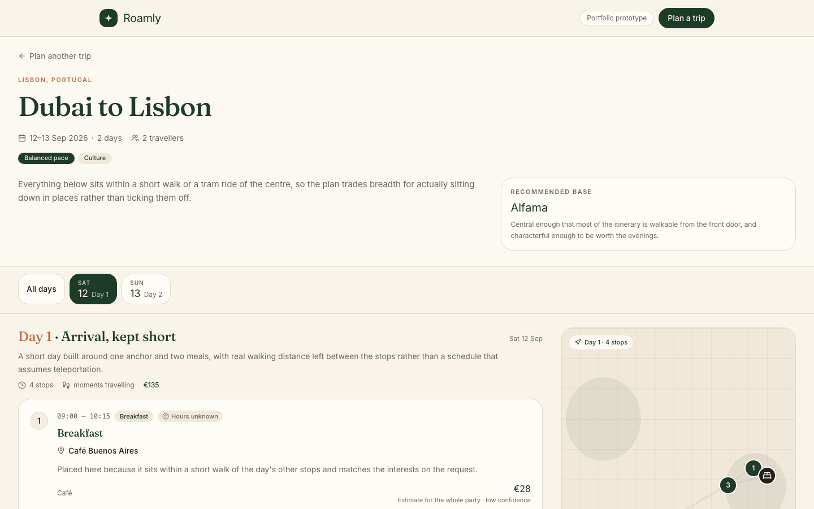
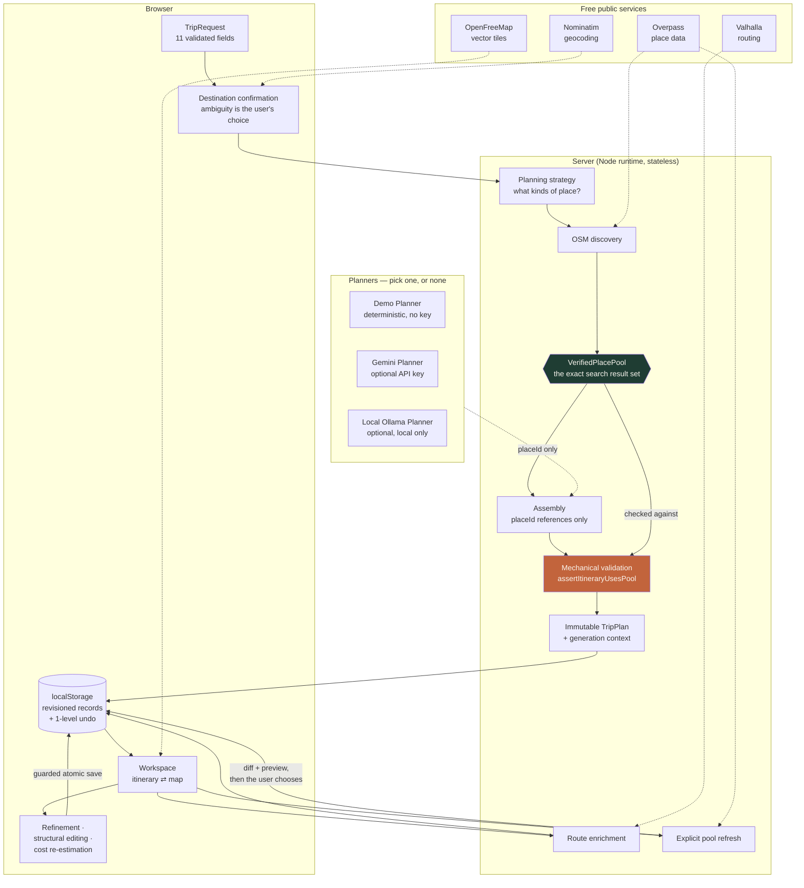

# Roamly

**Day-by-day travel itineraries where every single place is real — and the app can prove it.**

A trip planner that turns a budget, some dates and a vague sense of what you like into a scheduled
itinerary with a map. The interesting part is not the itinerary. It is that a language model is
*structurally incapable* of inventing a restaurant, a coordinate or an opening time in it.

Runs with **no API key, no database, no billing account and no cloud project**.

> **Portfolio prototype.** It is not production infrastructure, and it leans on donated public
> services. Every limitation is documented rather than hidden.

<!-- Replace with the deployment URL once live: -->
**Live demo:** _not yet deployed_ · **Walkthrough:** [`docs/DEMO_SCRIPT.md`](docs/DEMO_SCRIPT.md)



---

## What it does

1. You give it a destination, dates, a budget, a pace and the things you care about.
2. It makes you **choose which destination you meant** — there is a Lisbon in Portugal and one in Ohio.
3. A planner decides what *kinds* of place each day needs.
4. The **server** searches OpenStreetMap for exactly those and gets back a fixed set of real places.
5. The planner assembles days **referencing only ids from that set**.
6. The result is validated against the set, and only then saved — in your browser.
7. Afterwards you can calculate real walking and driving routes, check opening hours, and edit the
   itinerary in bounded ways.
8. If you **ask it to**, it looks up the landmarks in your trip on Wikidata and Wikimedia Commons and adds a
   short description, a founding year and one properly licensed photograph.

Step 8 never happens on its own — not on landing, not during generation, not when you open a saved trip.
Wikimedia is volunteer-funded and the lookup is deliberately serial, so it runs only when you press
something. It covers **landmarks only**: no restaurants, no cafés, no ordinary hotels, and no ratings,
reviews, popularity or live prices from anywhere. See
[`docs/PLACE_INTELLIGENCE.md`](docs/PLACE_INTELLIGENCE.md).

---

## The one guarantee everything else rests on

**A model can only ever name a `placeId` that a real search returned.**

It cannot write a place name. It cannot write a coordinate. It cannot write an address, a phone number,
a rating or an opening time. Those fields are attached afterwards from the canonical provider record,
and the finished plan is checked against the search result set — including the candidates that were
*not* chosen, which is what makes it evidence rather than the plan vouching for itself.

If a plan references anything outside that set, the whole generation fails and **nothing is saved**.

So "the AI hallucinated a restaurant that does not exist" is not a bug to catch in review. It is a
shape the system cannot express.

The same rule survives every later edit: refinements, structural edits and imports all pass the same
assertion. The one narrow exception is documented below.

---

## Architecture



The diagram is Mermaid in this file — no binary to regenerate, and it renders on GitHub.

**Boundaries worth naming.** The server is stateless: it reads a plan, returns a plan, and forgets
both. Nothing is persisted server-side, which is why a failed generation cannot leave a partial trip.
Provider adapters are `server-only`; the browser reaches them exclusively through `/api/*`. No model
prompt, provider host or key name reaches a client bundle — verified against the built output, not
assumed.

---

## Product guarantees

| | |
| --- | --- |
| **Real places** | Every stop exists in OpenStreetMap, with its canonical id and attribution |
| **No invented facts** | Names, coordinates, addresses and hours come from the provider, never a model |
| **Estimates labelled as estimates** | Every money figure carries its basis, confidence and a disclaimer |
| **No exchange rates** | Each currency has its own hand-written band table; nothing is converted |
| **Honest opening hours** | Open / closed / **we do not know** — and never "closed" from absent data |
| **Real route geometry** | Actual road paths from OSM data, or an explicit "no route found" |
| **Atomic persistence** | Revisioned records, guarded writes, one-level undo, nothing half-saved |
| **Works with no AI** | The deterministic Demo Planner needs no key and is never passed off as AI |

---

## Opening hours: three states, not two

The app makes exactly two positive claims, and only when *all* of these hold: OpenStreetMap has an
`opening_hours` string, the parser could read it, the destination's timezone is known, and the local
date and time are known.

- **Open then** — the *whole* visit fits inside one published interval. Not just the arrival: a
  16:30–18:00 visit to a museum closing at 17:00 is reported as a clash.
- **Closed then** — the hours we read do not cover the slot.

Everything else is **"hours unknown"** or **"hours not checked"**, with a distinct icon and its own
wording — never a colour alone, and never green. No tag recorded, a syntax outside the supported
subset (`PH off`, seasonal ranges, `sunrise-sunset`), an unknown timezone, or a clocks-change date
where the scheduled local time does not exist: none of those is ever reported as a closure.

The parser covers a deliberate subset and refuses anything outside it **whole**. `Mo-Fr 09:00-17:00;
PH off` read as "weekdays nine to five" is right six days a week and wrong on the day it matters.

Timezones come from a curated table: a single-zone country resolves from its country code, a
multi-zone country only on a city match. "Portugal" is not an answer when Lisbon and Funchal are an
hour apart. Your device's timezone is never used.

---

## Costs: why there is no exchange rate

A destination cost profile holds **no money**. It holds dimensionless weights (how a budget divides
between categories there) and relative multipliers (how expensive each kind of place is compared with
the others there). Every figure is then allocated from *your* budget and clamped into a hand-written
band table for *your* currency.

There is no conversion function anywhere in the codebase. A rate is a live financial fact with a
timestamp, there is no feed for one, and inventing today's rate would be wrong in a way nobody could
see. Independent tables are also more accurate — a coffee in Dubai and a coffee in Lisbon do not
differ by an exchange rate.

---

## Safe editing

Every edit is a specific typed action. There is no free-text box, deliberately: a prompt field could
ask for a place that was never found, and the schema would be no defence.

| Action | Needs an AI planner? |
| --- | --- |
| Replace a stop · replace a backup · make a day cheaper/calmer/fuller · regenerate | Yes |
| Add a backup to the itinerary · move a stop to another day | No |
| Fix an opening-hours clash · recalculate cost estimates | No |
| Calculate or retry routes | No — OpenStreetMap road data |
| Refresh the available places | No — it needs OpenStreetMap, not a model |
| Export · import · undo | No |

**Refreshing the available places** re-runs the search and shows you exactly what changed — added,
no longer found, records corrected, and how many places *your trip uses* are missing. Nothing is
written until you choose what happens to those, and neither option picks a replacement for you.

**The one narrow exception to the pool rule.** A refreshed search can lose a place your itinerary is
built on — usually because a mapper retagged it, not because it closed. Such a place moves into an
explicit `retainedPlaces` record: out of the active pool, flagged in the interface, and excluded from
every candidate list. The invariant becomes *"every newly selected place must be in the active pool; an
existing reference may resolve to a recorded retained place the plan still uses"* — enforced
mechanically, with a hard failure if a retained entry is unreferenced or claims to be in both.

---

## Your data

Trips are saved in **your browser only**. No account, no server, no database. A trip link will not
open on another device, and clearing site data deletes it.

That is a real single point of failure, so the app gives you tools rather than reassurance:

- **A storage panel** — trip count, exact bytes used, the largest trips, and the browser's own quota
  estimate shown *separately* (never divided into a fabricated percentage)
- **Export as JSON** — the whole record: plan, place pool, retained places, revision, undo snapshot
- **Import** — validated against every schema *and* the pool assertion, as either a new copy or a
  confirmed replacement. A malformed or tampered file writes nothing
- **Quota handling** — a save that will not fit is refused *before* the state changes, so a full
  browser never shows you a trip that silently vanishes on reload

---

## Offline

Not an offline app, and it does not claim to be. There is no service worker: a hard reload with no
network loads nothing.

What does work offline: reading saved trips, opening-hours checks, cost recalculation, structural
edits, export and import. What does not: maps, place search, route calculation, AI planning. Those
controls disable themselves with a reason rather than starting a request that cannot succeed.

---

## Stack

- **Next.js 16** (App Router, Turbopack, typed routes) · **React 19** · **TypeScript** (strict)
- **Zod 4** — every boundary, in both directions
- **Zustand** + `persist` — revisioned records in `localStorage`
- **Tailwind CSS 4** + shadcn/ui primitives · **Framer Motion**
- **MapLibre GL** via `react-map-gl` — dynamically imported, absent from the landing bundle
- **Vitest** — 1,582 unit tests · a **Chrome DevTools Protocol** harness for browser verification
- No ORM, no database, no auth library, no analytics SDK

---

## Local setup

```bash
git clone <this-repo> && cd roamly
npm install
npm run dev          # http://localhost:3000
```

That is all. No `.env.local` is required — the map renders, place discovery and routing work against
free public services, and trip generation uses the Demo Planner.

To try a real model, copy `.env.example` to `.env.local` and set **one** of:

```bash
GEMINI_API_KEY=...                       # free tier: https://aistudio.google.com/apikey
OLLAMA_BASE_URL=http://localhost:11434   # fully local: https://ollama.com
```

---

## Environment variables

Every variable is **optional**. None is required to build, run or deploy.

| Variable | Purpose | Default |
| --- | --- | --- |
| `ROAMLY_AI_PROVIDER` | `auto` · `gemini` · `ollama` · `deterministic` | `auto` |
| `GEMINI_API_KEY` | Enables the Gemini Planner | unset → not offered |
| `GEMINI_MODEL` | Model id | `gemini-2.5-flash` |
| `GEMINI_BASE_URL` | API host override (fixture servers in verification runs) | Google's |
| `OLLAMA_BASE_URL` | Enables the local Ollama Planner | unset → not offered |
| `OLLAMA_MODEL` | Model id | `qwen3:8b` |
| `ROAMLY_NOMINATIM_BASE_URL` | Geocoding endpoint | public Nominatim |
| `ROAMLY_OVERPASS_BASE_URL` | Place-data endpoint | public Overpass |
| `ROAMLY_VALHALLA_BASE_URL` | Routing endpoint | public Valhalla demo |
| `ROAMLY_CONTACT_URL` | Your contact URL, sent in the provider `User-Agent` | a generic URL |
| `ROAMLY_ROUTING_CLIENT_ID` | Identifies you to the routing operator | a generic id |
| `NEXT_PUBLIC_SITE_URL` | Canonical origin, for canonical tags and the social image | `https://roamly.vercel.app` |
| `NEXT_PUBLIC_BASEMAP_STYLE_URL` | Vector-tile style URL | OpenFreeMap `positron` |

**No secret is `NEXT_PUBLIC_`.** The two that are public are a site URL and a tile style URL — both
have to reach the browser to work, and both are values you are willing to publish. A tile provider
requiring a secret token needs a server-side proxy, not the variable.

---

## Running the tests

```bash
npm test                          # 1,582 unit tests — no network, no providers
npm run verify:browser            # 188 checks in real Chrome against local fixture servers
npx tsc --noEmit && npm run lint && npm run build

# Optional, and they do hit real services:
npm run test:integration:osm
npm run test:integration:routing
npm run test:integration:ai:gemini    # skips cleanly without a key
npm run test:integration:ai:ollama    # skips cleanly without a host

# Against a deployment (or a local production build):
PRODUCTION_BASE_URL=https://example.vercel.app npm run test:smoke:production
```

The browser suite drives real Chrome over CDP against local fixture servers for every provider, so it
is repeatable and never touches a public service.

---

## Deployment

Deploys to Vercel with **zero configuration**. See [`docs/DEPLOYMENT.md`](docs/DEPLOYMENT.md) for the
full procedure, route timeouts, verification checklist and rollback.

---

## Public-provider limitations

Read this before pointing real traffic at it. Every one of these is a free community service, and the
app's pacing, caching, single-retry and identifying headers are a floor rather than a licence.

**Nominatim** (geocoding) — the public endpoint is demo-grade with a strict usage policy. There is no
search-as-you-type anywhere in the app; every lookup needs an explicit submit. A server-side rate
limiter and a 24-hour cache sit in front of it. Meaningful traffic needs self-hosting or a commercial
geocoder.

**Overpass** (place data) — public instances are frequently slow or refuse. Partial discovery is
represented explicitly: "this category returned nothing" and "this query did not complete" are
different states and are shown as such. Meaningful traffic needs a dedicated instance.

**Valhalla** (routing) — the public demo server is not guaranteed production infrastructure. Routes
carry **no live traffic** and transit is unsupported: no transit feed is loaded, and labelling a
walking route as transit would misdescribe what you are being told to do. Self-host it — it runs on a
small VM with a country extract.

**OpenFreeMap** (tiles) — donation-funded, appropriate for light use and **not** a production CDN.
Attribution is required and must stay visible. No bulk downloading, no offline tile caching, no
prefetching beyond the viewport. Replacing it is one environment variable and changes nothing about
the itinerary, routing, pool or persistence contracts.

---

## Security model

- **No secrets in the browser.** No key, model prompt, provider host or server module reaches a client
  bundle — verified by grepping the built output, and by the production smoke test.
- **Everything validated at both edges.** Zod on every request and every response. Provider payloads
  are normalised server-side; the browser never sees a raw one.
- **Bounded by construction.** Body caps on every write route, a candidate cap, a pool cap, a route
  cap, a per-day stop cap, an import size cap applied *before* parsing, and a bounded
  `opening_hours` parser with no catastrophic backtracking.
- **No dynamic execution.** No `eval`, no constructed code paths, no HTML from provider content.
  Imported JSON is data only.
- **Errors say nothing useful to an attacker.** Our own codes and sentences; never a stack trace, a
  provider status or a query string.
- **Development surfaces do not exist in production.** `/dev/*` returns 404, asserted by the smoke
  test.
- **Logs contain no travel data.** No destination, no place names, no itinerary, no prompts, no model
  output. Operation, provider category, result category, duration, request id.
- **Injection is structurally prevented.** Overpass queries are built from an allowlisted tag table,
  never from user text.
- **Dependencies are checked, not counted.** `npm audit --omit=dev` reports three advisories, each with
  no forward fix and each verified unreachable — see [`SECURITY.md`](SECURITY.md) for the evidence.

---

## Intentional omissions

Not built, and not by accident:

**Accounts, sync, sharing, collaboration.** Trips are browser-local. Adding an account means a
database, a privacy policy and an auth surface — all of which would dwarf the product.

**Live prices, live availability, booking.** No inventory of any kind. Flight and accommodation figures
are always labelled estimates and link out to a real search.

**Transit routing.** No transit feed is loaded, so a transit leg can only ever be an estimate.

**Currency conversion.** See above — there is no rate feed, so there is no rate.

**Full `opening_hours` grammar.** Public holidays, school holidays, seasonal ranges, sunrise/sunset and
week numbers are shown as recorded rather than interpreted.

**Drag-and-drop scheduling.** Position is chosen from a list, which is keyboard-operable and needs no
touch story of its own.

**Multi-city trips, date changes, more than one level of undo.**

**Production infrastructure.** This is a prototype on donated services. It does not claim to scale, and
`docs/DEPLOYMENT.md` says exactly what to replace if it needed to.

---

## Screenshots

All captured from a **production build** against local fixture providers, so they are reproducible and
contain no development affordance, fixture URL or key name — `npm run screenshots` regenerates the set
and asserts those properties rather than trusting them.

| | |
| --- | --- |
| [Landing page](docs/screenshots/01-landing.png) | [Destination confirmation](docs/screenshots/02-destination-confirmation.png) |
| [Generation in progress](docs/screenshots/03-generation-progress.png) | [Itinerary and map](docs/screenshots/04-itinerary-and-map.png) |
| [Routed geometry](docs/screenshots/05-routed-geometry.png) | [Refinement panel](docs/screenshots/06-refinement-panel.png) |
| [Opening-hours accuracy](docs/screenshots/07-opening-hours.png) | [Pool-refresh preview](docs/screenshots/08-pool-refresh-preview.png) |
| [Saved trips and storage](docs/screenshots/09-saved-trips-and-storage.png) | [Mobile itinerary](docs/screenshots/10-mobile-itinerary.png) |

The map renders its schematic fallback in these captures: headless Chrome has no WebGL and the fixture
environment reaches no tile host. That fallback is a real product state — it is what a visitor without
WebGL sees — but it is not what the map looks like in a browser.

---

## Documentation

- [`docs/ARCHITECTURE.md`](docs/ARCHITECTURE.md) — the no-invention boundary, provider contracts,
  the immutable plan builder, opening-hours and cost models, structural editing, the pool lifecycle
- [`docs/BUILD_PLAN.md`](docs/BUILD_PLAN.md) — what shipped in each phase, every deviation, and every
  known limitation
- [`docs/PLACE_INTELLIGENCE.md`](docs/PLACE_INTELLIGENCE.md) — landmark enrichment: scope, identity ranking,
  the licence gates, budgets and continuation, what a card may show, and the current limitations
- [`docs/PROVIDER_RESEARCH.md`](docs/PROVIDER_RESEARCH.md) — which external providers were evaluated, the
  licence terms behind each verdict, and what Roamly may fetch, persist, export and display
- [`docs/DEPLOYMENT.md`](docs/DEPLOYMENT.md) — deploying, verifying, rolling back
- [`docs/LAUNCH_CHECKLIST.md`](docs/LAUNCH_CHECKLIST.md) — the exact pre-deploy and smoke checklist
- [`docs/DEMO_SCRIPT.md`](docs/DEMO_SCRIPT.md) — a two-minute walkthrough

---

## Attribution

Map data © [OpenStreetMap](https://www.openstreetmap.org/copyright) contributors, ODbL.
Tiles and style by [OpenFreeMap](https://openfreemap.org) using
[OpenMapTiles](https://openmaptiles.org). Geocoding by [Nominatim](https://nominatim.org); place data
via the [Overpass API](https://overpass-api.de); routing by [Valhalla](https://valhalla.github.io/valhalla/).
Rendering by [MapLibre GL JS](https://maplibre.org).

Landmark facts from [Wikidata](https://www.wikidata.org) (CC0). Landmark photographs from
[Wikimedia Commons](https://commons.wikimedia.org), each under **its own licence**, credited to its own
creator on the card that shows it — Roamly refuses any file whose licence it cannot identify exactly, and
never modifies the image. Neither requires a credential.

Everything above is free and open source.
